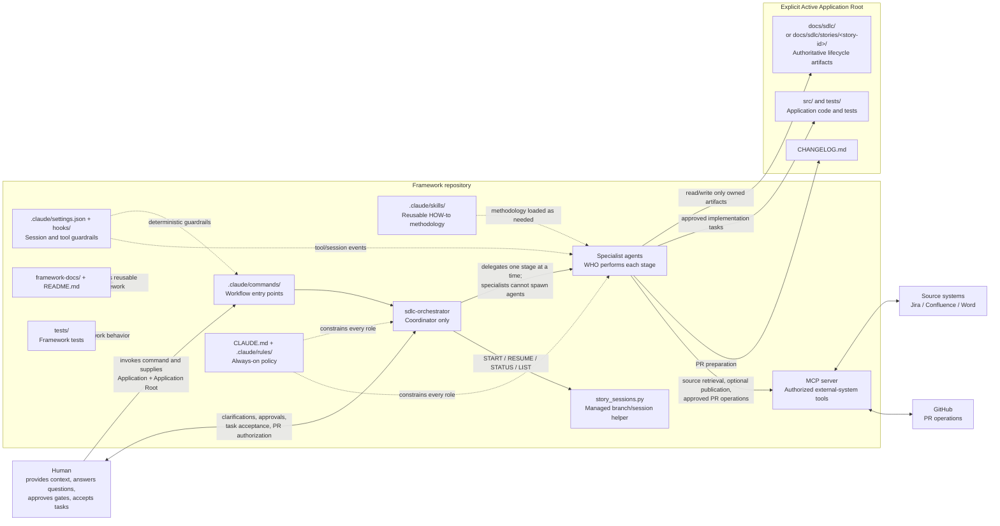

# Claude Agentic SDLC Architecture

This document maps the agents and supporting pieces in this repository. It
describes the framework configuration, not the internal architecture of a
particular application.

## System context



### Component responsibilities

| Component | Purpose |
|---|---|
| `CLAUDE.md` and `.claude/rules/` | Always-on repository policy, safety, scope, Git, and workflow requirements. |
| `.claude/agents/` | Defines each agent's role, inputs, allowed ownership, gates, and expected output. |
| `.claude/skills/` | Reusable methodology, loaded when relevant; skills do not own lifecycle state. |
| `.claude/commands/` | User-facing entry points for the orchestrated lifecycle or a single stage. |
| `.claude/settings.json` and `.claude/hooks/` | Deterministic session/tool-event guardrails and evidence reminders. |
| `mcp/sdlc_integrations/` and `.mcp.json` | Authorized Jira, Confluence, and GitHub capabilities. Credentials are not read by agents from configuration files. |
| `.claude/scripts/story_sessions.py` | Performs managed story branch/session operations; it does not replace artifact-based workflow state. |
| `framework-docs/`, `README.md`, and `tests/` | Reusable framework documentation and framework-level validation. |
| Active Application Root | Isolated location for that application's source, tests, SDLC artifacts, and changelog. |

The orchestrator determines progress from the active run's canonical artifacts,
not from chat history. Each specialist owns only its designated artifact or
implementation scope. Application-specific files must not be put in framework
locations.

## Lifecycle and agent handoffs

```mermaid
flowchart TD
    Start["User starts /sdlc-orchestrate<br/>or a stage command"]
    Context["Establish Application,<br/>Application Root, source and run context"]
    Session{"Managed story session?"}
    SessionAction["story_sessions.py<br/>START / RESUME / STATUS / LIST"]
    State["Orchestrator reads authoritative<br/>artifacts and finds earliest incomplete gate"]

    Req["requirements-analyst<br/>source → requirements.md"]
    ReqGate{"Human approves<br/>requirements?"}
    Arch["solution-architect<br/>requirements → architecture.md"]
    Design["design-reviewer<br/>independent design-review.md"]
    DesignGate{"Review permits progression<br/>and human approves architecture?"}
    Plan["implementation-planner<br/>architecture → dependency-ordered impl-plan.md"]
    PlanGate{"Human approves plan?"}
    Impl["implementation-engineer<br/>one READY IMP task per delegation"]
    Accept{"Human accepts<br/>implemented task?"}
    More{"More implementation<br/>tasks remain?"}
    CodeReview["code-reviewer<br/>independent code-review.md"]
    Verify["verification-engineer<br/>independent verification.md"]
    Pr["pr-preparer<br/>CHANGELOG.md + pull-request.md"]
    PrGate{"Human explicitly authorizes<br/>commit / push / PR?"}
    Publish["Optional user-story-documenter<br/>publishes finalized story docs"]
    Done["Lifecycle artifacts remain<br/>the source of truth"]
    Clarify["Return clarification questions<br/>to human; update requirements"]
    Rework["Route findings to<br/>the owning specialist"]
    Stop["Stop at gate or report blocker"]

    Start --> Context --> Session
    Session -->|"Yes"| SessionAction --> State
    Session -->|"No"| State
    State --> Req
    Req --> ReqGate
    ReqGate -->|"Questions / unresolved material decision"| Clarify --> Req
    ReqGate -->|"Explicit approval"| Arch
    Arch --> Design --> DesignGate
    DesignGate -->|"Rework required"| Rework
    Rework -->|"Architecture changes"| Arch
    Rework -->|"Implementation changes"| Impl
    DesignGate -->|"Review passes + explicit approval"| Plan
    Plan --> PlanGate
    PlanGate -->|"Not approved"| Stop
    PlanGate -->|"Explicit approval"| Impl
    Impl --> Accept
    Accept -->|"Not accepted"| Stop
    Accept -->|"Accepted; task marked DONE"| More
    More -->|"Yes; next task is dependency-eligible"| Impl
    More -->|"No"| CodeReview
    CodeReview -->|"Rework required"| Rework
    CodeReview -->|"Final verification allowed"| Verify
    Verify -->|"Fail / blocked"| Rework
    Verify -->|"Pass permits PR preparation"| Pr
    Pr --> PrGate
    PrGate -->|"No authorization or remote blocker"| Stop
    PrGate -->|"Explicit per-run authorization"| Done
    Done -. "Only when explicitly requested" .-> Publish
```



Human approval is required at requirements, architecture, plan, each
implementation task, and PR side-effect gates. Design review, code review, and
final verification are independent roles; none may silently rewrite the work it
reviews. The PR is never merged automatically.

## Agent catalog

There are 11 agents in the current orchestrated framework roles below, plus
three additional agent files describing an older workflow. The orchestrator is
the only coordinator; specialist agents do not invoke one another.

### Current lifecycle and framework agents

| Agent | When it runs | Main work and owned output |
|---|---|---|
| `sdlc-orchestrator` | Main session for `/sdlc-orchestrate` | Reads artifact status, delegates the next stage, presents human gates, and routes findings. Owns no specialist artifact and does not implement or review. |
| `requirements-analyst` | Requirements stage and when clarifications return | Reads the authoritative Jira, Confluence, or Word source; asks about material gaps; owns `requirements.md`. |
| `solution-architect` | After requirements approval; again to record human approval | Designs the technical solution without changing product requirements; owns `architecture.md`. |
| `design-reviewer` | After architecture draft and after rework | Independently checks architecture against approved requirements; owns `design-review.md`. |
| `implementation-planner` | After architecture approval | Creates dependency-aware `IMP-###` tasks and records plan approval/task state; owns `impl-plan.md`. |
| `implementation-engineer` | One approved, READY task at a time | Implements exactly one task, runs relevant checks, records evidence in `implementation-log.md`, and leaves the task pending human acceptance. |
| `code-reviewer` | After all implementation tasks are accepted | Independently reviews source, tests, and lifecycle evidence; owns `code-review.md`. |
| `verification-engineer` | When code review allows progression | Independently verifies approved FRs, NFRs, and ACs; owns `verification.md`. |
| `pr-preparer` | When final verification allows PR preparation | Prepares changelog/PR evidence and, after explicit authorization, performs allowed Git and PR operations; owns `CHANGELOG.md` and `pull-request.md`. Never merges. |
| `user-story-documenter` | Optional, explicitly requested after the SDLC | Publishes finalized, story-scoped repository evidence to Confluence; it does not set lifecycle state. |
| `framework-docs-maintainer` | When reusable framework docs need synchronization | Updates only `framework-docs/**` and root `README.md`; reports implementation inconsistencies rather than fixing them. |

### Additional legacy agent files

These files are present in `.claude/agents/` but are not in the current
orchestrator's specialist routing list. Do not confuse them with the current
roles above.

| Agent file | Described workflow |
|---|---|
| `implementer` | Older draft-first implementation flow, using `docs/impl-plan.md` and per-task approval. The current workflow uses `implementation-engineer` and the supplied SDLC Artifact Directory. |
| `verifier` | Older test/report flow writing `docs/verification-report.md`. The current workflow uses `verification-engineer` and `verification.md`. |
| `pr-creator` | Older draft PR/changelog flow. The current workflow uses `pr-preparer`, `pull-request.md`, and explicit authorization for external side effects. |

## Supporting workflow files

### Commands: user entry points

Commands are in `.claude/commands/`. The orchestrated entry point is
`/sdlc-orchestrate`; the stage-specific commands are:

- `/sdlc-requirements`
- `/sdlc-architecture`
- `/sdlc-design-review`
- `/sdlc-implementation-plan`
- `/sdlc-implement-task`
- `/sdlc-code-review`
- `/sdlc-final-verification`
- `/sdlc-pr-preparation`
- `/publish-story-documentation`

### Skills: reusable methods

Skills are in `.claude/skills/`: `requirements-analysis`,
`architecture-design`, `design-review`, `implementation-planning`,
`task-implementation`, `code-review`, `final-verification`,
`pull-request-preparation`, and `user-story-documentation`.

### Hooks: deterministic guardrails

Hooks configured through `.claude/settings.json` include session-start
context, pre-tool policy enforcement, and post-tool evidence/audit metadata.
They supplement the agent instructions; hook tests do not prove runtime
behavior in every Claude Code version.

### Artifact ownership and location

For an ordinary application run, the lifecycle artifacts live under
`<application-root>/docs/sdlc/`. For a managed story, they live under
`<application-root>/docs/sdlc/stories/<story-id>/`.

```text
requirements.md          requirements-analyst
architecture.md          solution-architect
design-review.md         design-reviewer
impl-plan.md             implementation-planner
implementation-log.md    implementation-engineer
code-review.md           code-reviewer
verification.md          verification-engineer
pull-request.md          pr-preparer
CHANGELOG.md              pr-preparer, at Application Root
```

The source story is retrieved through the authorized MCP integration (or the
approved local Word workflow). Confluence publication and GitHub PR operations
are external actions and require the authorization described by their agent
instructions.
